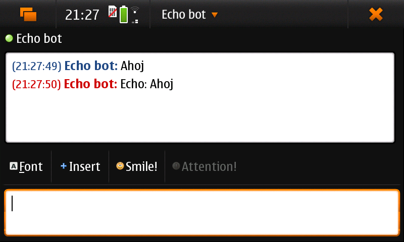

# purple-echo

A test protocol plugin for libpurple (step 0 of the native Signal integration, see `DOC/signal-native.md`). It answers every
message with `Echo: <message>`. It proved that the stock Maemo messaging UI (Settings > Accounts, Conversations, Mission
Control, telepathy-haze) accepts a libpurple protocol that the system did not ship with.

An account "Echo (test)" appears in Settings > Accounts, the contact is `echo-bot`:

What the package installs (the same four things any new protocol needs): the plugin in `/usr/lib/purple-2` (symlink to
`/opt/purple-echo`), a `[Protocol echo]` block in `/usr/share/telepathy/managers/haze.manager` (backup kept, removed by
`postrm`), the account profile `/usr/share/osso-rtcom/echo.profile` and an icon. Mission Control reads these files at start,
so reboot after installing.

Build: `make debs APP=purple-echo`, tests on the phone: `make -C apps/purple-echo test`. It is only a test, not in the apt
repository; remove it with `dpkg -r purple-echo` once Signal works (`libsignal-purple` replaces it).
